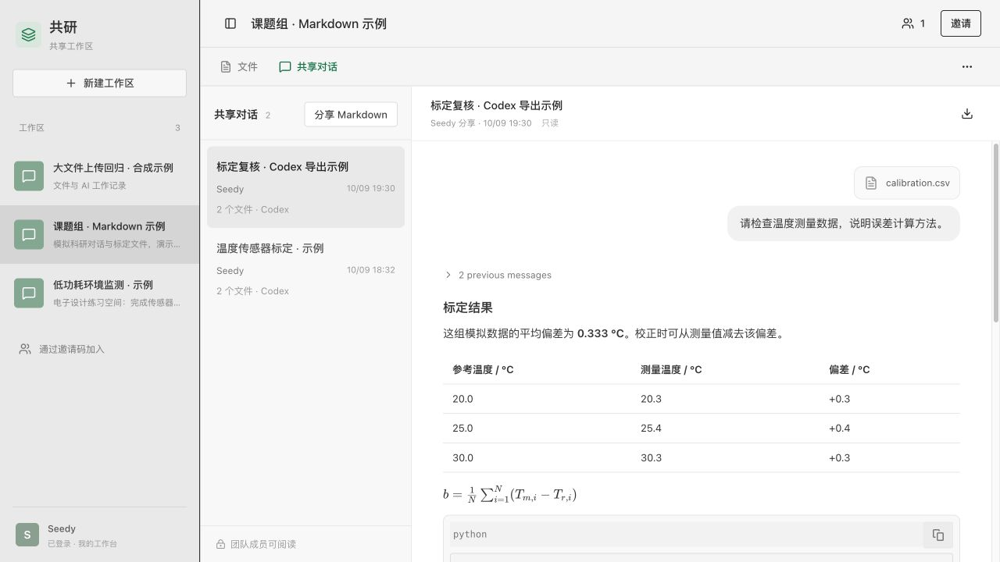
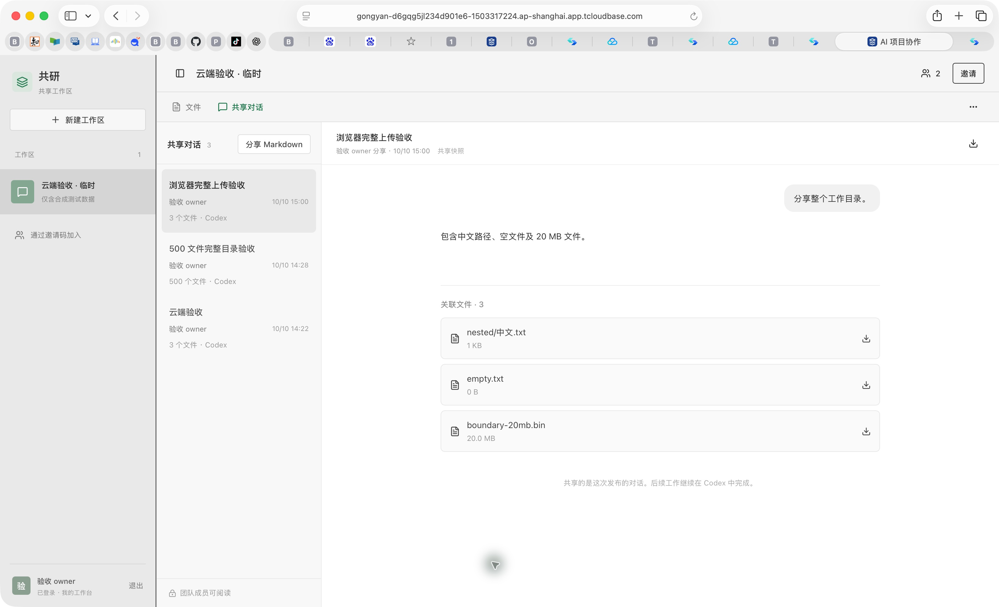

<p align="center">
  
</p>

<h1 align="center">共研 · Gongyan</h1>

<p align="center"><strong>把 AI 对话和成果文件，一起交给伙伴。</strong><br />Share the conversation. Share the work.</p>

<p align="center">
  面向课题组、电子设计与课程项目的轻量共享工作区。<br />
  继续在 Codex 中工作，上传 Markdown 与工作目录，让团队读懂你的过程、拿到你的成果。
</p>

<p align="center">
  <a href="https://gongyan-d6gqg5jl234d901e6-1503317224.ap-shanghai.app.tcloudbase.com/">体验早期版本</a> ·
  <a href="#三步分享">使用方法</a> ·
  <a href="docs/DEVELOPMENT.md">开发指南</a> ·
  <a href="tencent/README.md">部署指南</a> ·
  <a href="https://github.com/liuxyun-eng/gongyan/issues">反馈建议</a>
</p>

> **v0.1 · 早期预览**：已支持登录、工作区邀请、对话共享与目录上传。示例和截图均使用合成测试资料；仓库不包含用户上传的对话、附件、数据库或部署凭证。项目独立开发，与 OpenAI 无官方关联。



## 为什么做共研

你用 AI 整理了一份实验方案、写了一段分析代码，或者完成了课程项目。把最后一段回答发到群里，伙伴仍然不知道：问题怎么提出、结论怎么得到、文件在哪里。

共研把一次 AI 工作保存为可阅读、可下载的共享快照。对话和文件留在同一个工作区，伙伴可以复核过程，再拿着成果继续工作。

## 三步分享

1. **建立工作区**：注册并登录，创建工作区，把邀请码发给伙伴。
2. **上传本次工作**：在 Codex 复制对话为 Markdown，回到共研点“分享 Markdown”，粘贴内容与工作目录路径。
3. **一起复核成果**：确认文件清单并发布。成员可阅读对话、复制消息、下载文件。

路径上传无需打开 Finder。首次使用时，在下载的项目目录运行 `npm ci`、`npm run directory`，保持本机读取服务开启；本机开发的 `npm run share` 已包含此服务。预览时会打开一个小窗口读取目录，再自动将文件返回上传页。浏览器本身无法凭路径读取本机磁盘，因此云端路径上传也需要此服务；无需连接配置、Codex 数据库或 API Key。留空可直接分享对话。

## 已经能做什么

| 能力 | 当前行为 |
| --- | --- |
| 阅读 AI 对话 | 区分用户与 AI 消息，支持代码高亮、表格、公式、Mermaid 流程图、折叠工具记录和 Codex 文件下载标记 |
| 分享工作目录 | 上传普通成果文件及子目录，保留路径，支持同名文件和空文件 |
| 验证文件完整性 | 服务端读回文件并核对 SHA-256；全部文件校验成功后才发布对话 |
| 团队访问 | 账号登录、邀请码加入、工作区成员权限与私有文件存储 |
| 整理共享内容 | 复制消息；有权限的用户删除单段；作者右击卡片删除整条分享，文件保留在工作区 |
| 自行部署 | 提供前端、后端、数据库迁移及腾讯云部署脚本 |

Markdown 解析和展示不调用模型，也不会执行其中的 HTML 或命令。敏感凭证、系统文件与依赖目录会排除，并在上传清单中说明。

<details>
<summary>查看目录上传与附件下载示例</summary>



此图来自合成测试工作区，展示已上传附件，未使用用户研究资料。

</details>

## 本机运行

需要 Node.js **22.13+**。首次克隆后：

```sh
git clone https://github.com/liuxyun-eng/gongyan.git
cd gongyan
npm ci
mkdir -p .openai
cp -n hosting.example.json .openai/hosting.json
npm run build
```

首次空数据库需要依次应用三份迁移，再启动 `npm run share`；完整命令见[开发指南](docs/DEVELOPMENT.md#启动)。已有本机配置与数据库请保留，不要覆盖或重复迁移。

运行后，工作区在 `http://127.0.0.1:5173/`，本机目录上传助手在 `http://127.0.0.1:6062/`。跨电脑使用需要部署后端、数据库和文件存储，仅部署静态页面无法提供这些功能。

## 技术与验证

React 19 · TypeScript · Tailwind CSS · Streamdown · Shiki · KaTeX · Mermaid。腾讯云版本使用同源 API、PostgreSQL 与私有对象存储；本机开发版本使用 Wrangler / D1。

```sh
npx tsc --noEmit --incremental false
node --test tests/markdown-import.test.mjs tests/markdown-math.test.mjs tests/shared-transcript.test.mjs
node --test tests/file-citations.test.mjs tests/directory-bridge.test.mjs
npm run build:tencent
node scripts/build-tencent-server.mjs
```

上传与权限验证脚本见 `tests/` 和 `tencent/`。测试资料由脚本合成，不能用真实用户数据替代示例。故障重试、文件校验和删除行为详见[开发指南](docs/DEVELOPMENT.md)。

## 当前边界与后续方向

当前每次最多 **500 个文件**、单文件 **20 MB**、目录总量 **200 MB**；Markdown 最多 400 KB、200 条消息。对话列表显示最近 100 条，文件列表显示最近 5,000 个文件，尚未实现历史分页和临时文件自动清理。

本版提供只读共享快照，尚未实现后台实时同步、多人编辑或模型调用。Markdown 导出缺少角色或上下文时，展示无法完全复原原客户端。体验地址使用腾讯云测试域名，可能显示平台提示；正式推广还需要自有域名及运营准备。

接下来优先改进首次分享体验、导入兼容性、上传恢复与历史检索。这些是开发方向，尚未完成。

## 参与与反馈

欢迎在 [Issues](https://github.com/liuxyun-eng/gongyan/issues) 描述你的团队场景、遇到的问题或建议。复现时请提供脱敏后的最小示例、浏览器版本与操作步骤，不要贴真实研究资料或密钥。提交代码前请阅读[贡献指南](CONTRIBUTING.md)。

如果共研帮你省下了解释 AI 工作过程的时间，欢迎 Star，或把仓库分享给正在一起做项目的伙伴。

## English overview

**Gongyan is a lightweight workspace for sharing AI conversations and project files with research and student teams.** Keep working in Codex, export a conversation as Markdown, and upload it alongside a selected project directory. Teammates can review the conversation and download the files in one place.

This early preview includes account login, workspace invitations, Markdown rendering and verified directory uploads. It shares manually published snapshots; real-time synchronization and collaborative editing are not implemented. No model API key is needed to import or read conversations. All repository examples and screenshots contain synthetic data. Gongyan is an independent project, not an official OpenAI product.
